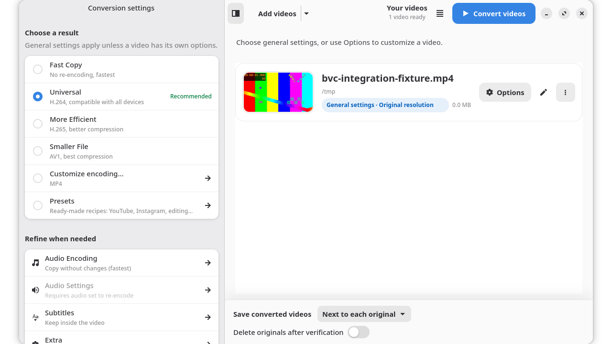

# Big Video Converter

Convert a queue of videos with FFmpeg, choose settings for each video, and preview edits before exporting.



- Apply one conversion profile to the queue or choose a preset and resolution for an individual video.
- Preview videos, trim segments, crop, rotate, mirror and adjust the image.
- Copy compatible streams or re-encode with available hardware or software encoders.
- Fit videos under a target size or split them into parts, stabilize, sharpen, reduce noise, apply color looks or shaders and change the frame rate.
- Follow each conversion and inspect completed, failed or cancelled results.

## Install

On BigLinux, with its package repositories enabled:

```sh
sudo pacman -S big-video-converter
```

Launch **Big Video Converter** from the application menu. For other Arch-based systems, the package must be available in your configured repositories; the source recipe is in [pkgbuild/PKGBUILD](pkgbuild/PKGBUILD).

The package requires Python 3.11 or later, GTK4, libadwaita 1.7 or later, PyGObject, Cairo, FFmpeg, python-mpv, PyOpenGL, libva-utils and VTE4. Hardware encoding also depends on the GPU, its driver and the encoders included in FFmpeg. The Nautilus extension is optional.

With **GPU** on Auto, the converter encodes on a GPU that supports the chosen codec. If several do, the one that alone encodes AV1 is chosen, else the one that alone encodes VP9; with equal support the order is NVIDIA, AMD, Intel. Support is read from each card (its VAAPI profiles, or a test frame on NVENC), and a card whose support cannot be read does not count as having it.

To run a checkout with these dependencies installed:

```sh
bash tools/compile-translations.sh
./big-video-converter/usr/bin/big-video-converter-gui
```

## Use

1. Add videos or a folder, or drop files onto the queue.
2. Choose general conversion settings in the sidebar.
3. Use **Options** on a video to select its own profile or resolution. Other videos keep their general settings.
4. Use **Edit video** to preview and adjust that video.
5. Choose whether to save beside each original or in one output folder, then select **Convert All**. While editing a video, **Convert This File** converts only that video.

Use Tab and Shift+Tab to move between controls, Enter or Space to activate them, and Escape to dismiss dialogs. The sidebar toggle makes the conversion settings available in narrow windows.

Originals are kept by default. The optional deletion setting applies only after the converted results pass validation. Closing during active conversions asks whether to keep converting or stop.

## Features

**Queue and profiles.** Each row has a video thumbnail, a settings summary and actions to play, inspect, edit or remove the video. Individual resolution choices include general, preset, original, landscape, portrait and custom dimensions. A conversion takes a snapshot of its settings when it starts, so later changes do not alter the active job.

**Editing.** Adjust brightness, contrast, saturation and hue; crop freely or to a selected aspect ratio; rotate or mirror the picture. Select time segments and export them separately or together, or remove them and keep the rest of the video. **Remove pauses** finds the pauses in speech, in the audio cleaned by DPDFNet (package `dpdfnet-native`), and replaces the segments with the speech between them, joined into one video; Undo brings back the segments it replaced, and every audio track gets the same cuts. It is made for speech, not music. Edits belong to the selected video.

**Encoding and streams.** Select video codecs and quality, copy or re-encode audio, configure noise reduction and normalization, and embed or extract subtitles. Available hardware paths depend on the local FFmpeg and driver capabilities; software fallback handles supported hardware failures.

**Presets.** Bundled TOML presets target sharing, editing and archival workflows. The Presets dialog can import or duplicate profiles and prepare a prompt for an external AI assistant. User presets live in `$XDG_CONFIG_HOME/big-video-converter/presets`, or `~/.config/big-video-converter/presets` when that variable is unset. See the [bundled presets](big-video-converter/usr/share/big-video-converter/presets) for examples.

## Development

Clone the repository and install the runtime dependencies above, plus pytest, NumPy, polib, gettext, ShellCheck and Xvfb for the regression suite.

```sh
git clone https://github.com/biglinux/big-video-converter.git
cd big-video-converter
bash -n big-video-converter/usr/bin/big-video-converter
shellcheck -S style big-video-converter/usr/bin/big-video-converter tools/*.sh
python3 -m compileall -q big-video-converter/usr/share/big-video-converter tests
python3 -m pytest -q tests
```

Tests generate their own media. The suite starts its own hidden Xvfb display and D-Bus session bus, so test windows never open on your desktop and never reach a converter you have running; set `BVC_TESTS_KEEP_SESSION=1` only inside an already isolated session. Without Xvfb the GTK tests are skipped. The [regression workflow](.github/workflows/backend-tests.yml) lists the CI dependencies and commands.

The GUI entry point is `main.py` under `usr/share/big-video-converter`. Queue scheduling prepares each job; `ui/conversion_start.py` resolves its settings and destination; `engine/conversion.py` supervises the shell converter under `usr/bin`. The supervisor publishes successful results and reports completion to the queue.

Thumbnails are made off the GTK thread, and shutdown waits for workers and conversions to finish before it leaves the main loop.

## Translation

The source catalogs are in `big-video-converter/locale`. After changing user-visible text:

```sh
bash tools/update-translations.sh
# Translate new entries in the .po catalogs, preserving placeholders and plurals.
bash tools/compile-translations.sh
```

The first command extracts the Python messages and merges all catalogs. The second validates them with `msgfmt` and writes the `.mo` files, which git does not track; the PKGBUILD compiles them as well.

## Packaging and release

The [PKGBUILD](pkgbuild/PKGBUILD) compiles translations and validates the desktop and AppStream files. It writes the package version into the installed `VERSION` file used by About and into the AppStream release list. A source checkout without that generated file reports a development version.

```sh
cd pkgbuild
makepkg
```

Inside a checkout the recipe builds the working tree: tracked files and new, unignored ones, uncommitted changes included. Commit new files before relying on a build from Git, which only the repository's history reaches. Outside a checkout it fetches the GitHub repository. The [package workflow](.github/workflows/build-package.yml) instead archives the checked-out revision, builds that exact source, runs Namcap and metadata checks, and retains the package and checksum as artifacts.

The desktop file and the metainfo share the identifier `br.com.biglinux.converter`.

## Contributing, support and license

Report a reproducible problem through [GitHub issues](https://github.com/biglinux/big-video-converter/issues), including the application version, relevant conversion options and a synthetic sample when possible. Remove private filenames and other personal information from logs before sharing them.

For a change, describe the affected workflow and the checks you ran.

Licensed under the [MIT License](LICENSE).
